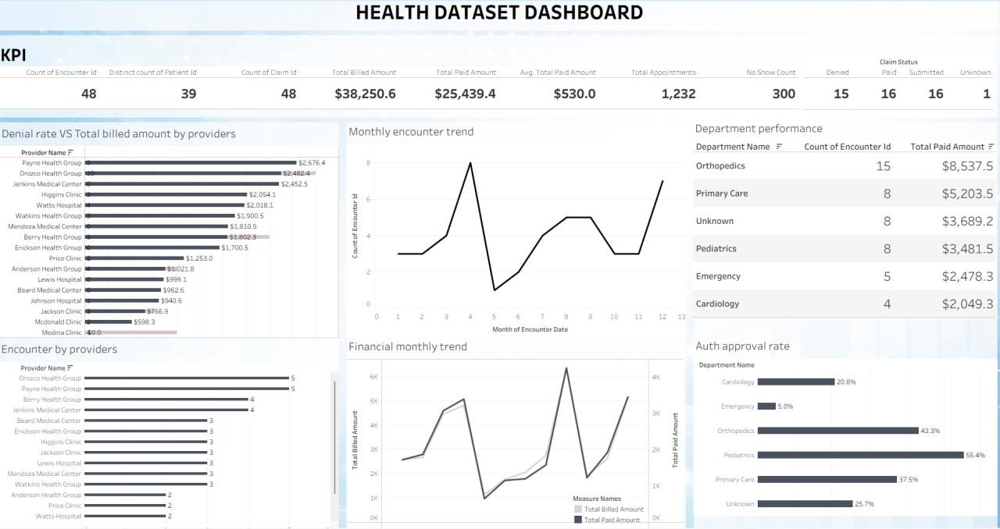

# Healthcare Provider Performance Analytics Dashboard

A Snowflake → Tableau analytics pipeline built on realistic, messy healthcare data — appointments, encounters, claims, prior authorizations, and provider/department reference data. The project follows a Bronze → Silver → Gold architecture and surfaces the KPIs a provider organization actually uses: collection rate, no-show rate, authorization approval rate, and denial breakdown.



## Key Findings

- **66.51% collection rate** — $38,250.59 billed vs. $25,439.36 collected across 47 encounters and 38 unique patients.
- **25.45% no-show rate** — 112 of 440 appointments.
- **Authorization approval rate varies sharply by department**: Pediatrics 55.4%, Orthopedics 43.3%, Primary Care 37.5%, Emergency just **5.0%**.
- Claim denials break down almost evenly across three preventable causes: missing documentation, expired coverage, and authorization required.

## Architecture

**Bronze** — raw data loaded as-is, no transformations.

**Silver** — type casting, text standardization (TRIM/INITCAP), deduplication (`ROW_NUMBER() OVER (PARTITION BY id ORDER BY created_at DESC)`), null handling via COALESCE, and status standardization through a `REFERENCE_CODES` lookup table instead of hardcoded CASE logic. A validation pass checks row counts, standardized-value domains, negative amounts, and orphaned foreign keys before anything moves to Gold.

**Gold** — a single analytics-ready table assembled via CTEs (department lookup, appointment aggregation, authorization aggregation), joined with COALESCE defaults and NULLIF-guarded rate calculations. Feeds seven summary outputs: `KPI_SUMMARY`, `MONTHLY_REPORT`, `PROVIDER_PERFORMANCE`, `CLAIM_SUMMARY`, `ENCOUNTER_SUMMARY`, `APPOINTMENT_SUMMARY`, `PRIOR_AUTH_SUMMARY`.


## Repo Structure

```
sql/
  01_bronze_to_silver.sql   -- cleaning, dedup, standardization, validation
  02_silver_to_gold.sql     -- Gold layer aggregation + final dashboard table
data/
  *.csv                     -- Gold layer summary tables (sample output)
diagrams/
  er-diagram.png            -- table relationship diagram
dashboard/
  tableau-dashboard.png     -- final Tableau dashboard
```

## Tools

Snowflake · SQL · Tableau

## Author

Munkhnasan (Mason) Otgonbold — Data Analyst focused on BI, data governance, and financial/healthcare analytics.
[LinkedIn](https://www.linkedin.com/in/munkhnasan-otgonbold-b319b6161) · [Portfolio](https://munkhnasan-portfolio.vercel.app)
