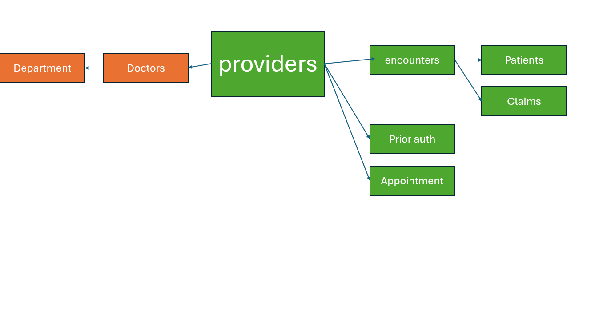

# Healthcare Provider Performance Analytics Dashboard

I used a healthcare billing practice dataset to explore how claims, appointments, and prior authorizations can be reported together. I wrote Snowflake SQL to standardize statuses, check records, and prepare data for Tableau.


## Reading the dashboard

The dashboard shows collections, no-shows, authorization outcomes, and denial categories in the practice dataset. Check appointment and authorization totals against their source tables before aggregating them from Gold. The provider-level totals can repeat across encounter and claim rows.

## Architecture

**Bronze**: raw data loaded as-is, no transformations.

**Silver**: type casting, text standardization (TRIM/INITCAP), deduplication (`ROW_NUMBER() OVER (PARTITION BY id ORDER BY created_at DESC)`), null handling via COALESCE, and status standardization through a `REFERENCE_CODES` lookup table instead of hardcoded CASE logic. A validation pass checks row counts, standardized-value domains, negative amounts, and orphaned foreign keys before anything moves to Gold.

**Gold**: a single analytics-ready table assembled via CTEs (department lookup, appointment aggregation, authorization aggregation), joined with COALESCE defaults and NULLIF-guarded rate calculations. Feeds seven summary outputs: `KPI_SUMMARY`, `MONTHLY_REPORT`, `PROVIDER_PERFORMANCE`, `CLAIM_SUMMARY`, `ENCOUNTER_SUMMARY`, `APPOINTMENT_SUMMARY`, `PRIOR_AUTH_SUMMARY`.



## Repo Structure

```
sql/
  01_bronze_to_silver.sql   -- cleaning, dedup, standardization, validation
  02_silver_to_gold.sql     -- Gold layer aggregation + final dashboard table
data/
  *.csv                     -- Gold layer summary tables (sample output)
diagrams/
  er-diagram.png            -- table relationship diagram
dashboard/
  tableau-dashboard.png     -- final Tableau dashboard
```

## Tools

Snowflake · SQL · Tableau

## Author

Munkhnasan (Mason) Otgonbold: Data Analyst focused on BI, data governance, and financial/healthcare analytics.
[LinkedIn](https://www.linkedin.com/in/munkhnasan-otgonbold-b319b6161) · [Portfolio](https://munkhnasan-portfolio.vercel.app)
